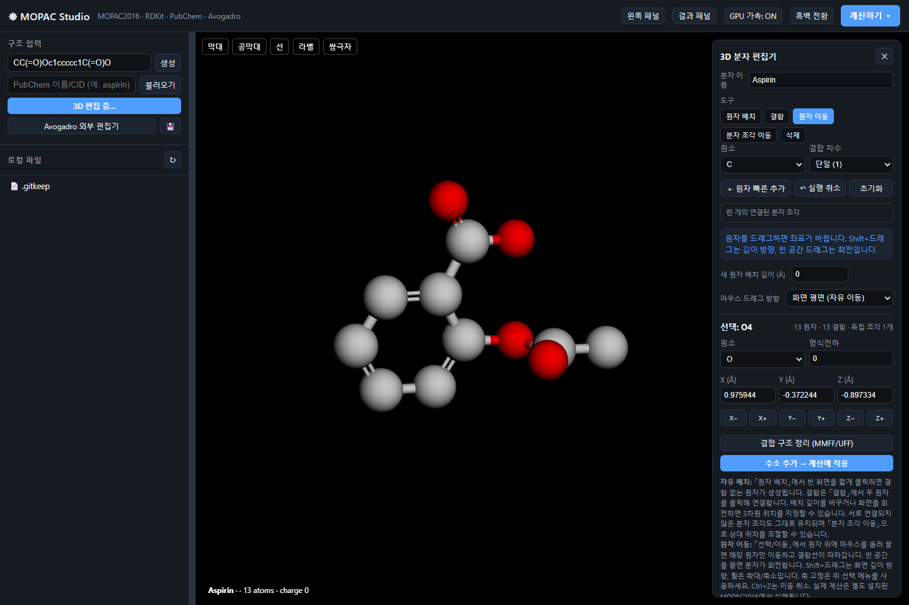

# ⚛ MOPAC Studio

분자를 직접 그리고, MOPAC 계산을 실행하고, HOMO/LUMO 오비탈을 3D로 확인하는 **로컬 웹 앱**입니다. Windows에서 사용·검증했으며, 화면은 웹 브라우저에서 열립니다.



## 설치하기 — Windows

### 1. 소스 다운로드

[최신 소스 ZIP 다운로드](https://github.com/jihojack/mopac-studio/archive/refs/heads/main.zip) → 압축을 풀어 주세요. Git 사용자는 다음 명령으로 받을 수도 있습니다.

```powershell
git clone https://github.com/jihojack/mopac-studio.git
cd mopac-studio
```

### 2. Python 설치

[Python 공식 사이트](https://www.python.org/downloads/)에서 **Python 3.11 64-bit**를 설치합니다. 설치 화면에서 **Add python.exe to PATH**와 Python Launcher를 선택하면 편리합니다. 지원 범위는 Python 3.11~3.13이며 3.11을 권장합니다.

### 3. 앱 설치 및 실행

1. **`Install.bat`**를 더블클릭합니다. 이 폴더의 `.venv`에 필요한 패키지를 설치합니다. 최초 설치에는 인터넷이 필요합니다.
2. **`Start.bat`** 또는 **`MopacStudio 실행.bat`**를 더블클릭합니다.
3. 자동으로 열린 브라우저 탭에서 사용합니다. 주소는 `http://127.0.0.1:5005`부터 사용 가능한 포트가 선택됩니다.

`Start.bat`도 설치되지 않은 패키지를 자동 설치하므로 바로 실행해도 됩니다. 시스템 Python에 앱 패키지를 직접 설치하지 않습니다.

콘솔 창 없이 사용하려면 **`Start-Background.bat`** 또는 **`MopacStudio 백그라운드 실행.bat`**를 사용합니다. 백그라운드 서버는 브라우저 연결이 약 90초간 없으면 종료됩니다. 최초 패키지 설치 때는 설치 창이 표시됩니다.

> MOPAC 없이도 SMILES 입력, 분자 편집, 파일 열기·저장은 사용할 수 있습니다. **양자화학 계산에는 별도의 MOPAC 실행 파일이 필요합니다.**

## MOPAC 연결하기

이 앱은 **MOPAC2016 Windows 실행 파일로 검증**했습니다. MOPAC 실행 파일·런타임 DLL·라이선스는 저장소에 포함하지 않습니다. 공식 배포 및 설치 정보는 [OpenMOPAC 다운로드](https://openmopac.net/download/)와 [설치 안내](https://openmopac.net/download/installer/)를 참고하세요. 현재 공식 배포판은 MOPAC2016 이후의 오픈소스 버전이므로, 최신 버전과의 모든 계산·출력 파싱 호환성은 아직 검증하지 않았습니다.

다음 중 하나로 실행 파일을 연결합니다.

**방법 A — 환경 변수로 지정**

PowerShell에서 실제 설치 경로를 지정하고 같은 창에서 실행하세요.

```powershell
$env:MOPAC_EXE = 'C:\실제설치경로\MOPAC2016.exe'
python launcher.py
```

계속 사용하려면 Windows의 **환경 변수 편집 → 사용자 변수**에서 `MOPAC_EXE`에 실행 파일의 전체 경로를 등록한 뒤 앱을 다시 실행합니다. 필요한 DLL은 MOPAC 배포판의 원래 폴더 구조를 유지하세요.

**방법 B — 기존 포터블 폴더 구조 사용**

```text
작업폴더/
├─ mopac-studio/
│  ├─ Start.bat
│  └─ app.py
└─ mopac2016/
   ├─ MOPAC2016.exe
   └─ ...배포판에 포함된 런타임 파일
```

앱 내부의 `mopac2016/MOPAC2016.exe`도 검색합니다. 환경 변수와 포터블 경로에 실행 파일이 없으면 시스템 `PATH`의 `MOPAC2016.exe`, `mopac.exe`, `mopac` 순서로 확인합니다.

## 처음 사용하기

### SMILES로 시작

왼쪽 SMILES 입력란에 `CCO`(에탄올), `O`(물), `c1ccccc1`(벤젠) 등을 입력하고 **생성**을 누릅니다. PubChem 이름/CID 검색도 지원하며, 검색에는 인터넷이 필요합니다.

### 원자와 결합을 직접 그리기

1. **화면에서 3D 그리기**를 누릅니다.
2. **원자 배치**에서 원소를 선택하고 빈 화면을 클릭합니다. 원자는 자동으로 결합하지 않습니다.
3. **결합**에서 결합 차수를 선택하고 원자 두 개를 차례로 클릭해 연결합니다.
4. **원자 이동**에서 원자를 드래그합니다. Shift+드래그는 깊이 방향이며 X/Y/Z축 고정도 가능합니다.
5. 필요하면 **결합 구조 정리 (MMFF/UFF)**를 사용합니다. 이 단계는 원래 배치한 좌표를 바꿀 수 있습니다.
6. **수소 추가 → 계산에 적용**을 누릅니다. 이 동작은 사용자가 배치한 원자의 좌표를 유지하면서 수소를 보완합니다.

Ctrl+Z와 **실행 취소**로 원자·결합 수정 및 이동을 되돌릴 수 있습니다. 지원 원소는 H, B, C, N, O, F, Si, P, S, Cl, Br, I입니다. 금속 배위결합과 특수 원자가 표현에는 제약이 있습니다.

**편집기의 X는 현재 구조를 보존하고 닫기**입니다. 다시 열면 이어서 편집할 수 있습니다. 닫힌 편집 초안은 수소/원자가 검사가 끝나지 않았으므로 계산 버튼이 비활성화됩니다. 다시 열어 **계산에 적용**하세요.

편집 초안은 **현재 탭 메모리**에 보존됩니다. 새로고침·종료 전에 왼쪽 저장 버튼으로 파일을 남겨 주세요. 저장한 구조와 계산 결과는 `workspace/`에 보관되며 Git에 포함되지 않습니다.

### 계산과 오비탈 보기

**계산하기**에서 전체 전하·스핀 다중도와 계산 종류를 선택합니다. 결과 카드에서 HOMO, LUMO 등의 버튼을 누르면 해당 오비탈의 등가면을 표시합니다. 파랑과 빨강은 파동함수의 서로 반대 위상이며, 전하의 부호를 뜻하지 않습니다. 등가면 슬라이더로 표시 범위를 조절할 수 있습니다.

주요 계산: 구조 최적화, 생성엔탈피, 원자 전하, 쌍극자, 결합차수, 분자오비탈, 진동·IR, 열화학, 용매화 등 22개 메뉴. IP/EA 일부 값은 오비탈 에너지 기반 근사이며, 전이상태·IRC에는 적절한 초기 구조가 필요합니다. pKa 메뉴는 PM6를 사용합니다. 메뉴가 제공된다고 모든 분자·조건에서 수렴하는 것은 아닙니다.

### 여러 분자 배치

서로 연결하지 않은 여러 분자를 배치하고 **분자 조각 이동**으로 상대 위치를 조절할 수 있습니다. 모든 원자는 한 시스템으로 계산에 들어갑니다. 화면은 선택한 **MO 하나**를 표시하므로, 분자 간 거리가 멀면 오비탈이 한 분자 쪽에만 나타날 수 있습니다. 다른 MO를 선택하면 반대쪽에 나타날 수 있습니다.

각 분자의 HOMO를 자동으로 동시에 표시하거나 상호작용 에너지 `E(복합체) − ΣE(단독 분자)`를 자동 산출하는 기능은 아직 없습니다.

## 문제 해결

| 증상 | 확인할 내용 |
|---|---|
| `python`을 찾을 수 없음 | Python 3.11 64-bit 설치 및 PATH/Python Launcher 설정 |
| 패키지 설치 실패 | 인터넷 연결 확인 후 설치 창의 오류를 확인하고 `Install.bat` 재실행 |
| MOPAC 실행 파일을 찾을 수 없음 | `MOPAC_EXE` 경로, 실행 파일 및 배포판 런타임 파일 확인 |
| MMFF/UFF 정리 실패 | 현재 초안은 유지됩니다. 겹친 원자·비정상 결합 거리를 수정하고 재시도 |
| 수소 보정 생략 경고 | 입력 원자의 좌표는 유지됩니다. 수소 배치를 확인하고 계산에 적용 |
| 편집기 API 404 | 오래된 서버 탭을 닫고 현재 폴더의 실행 버튼으로 새로 열린 주소 사용 |
| 수정 후에도 예전 오류 발생 | 구조를 저장하고 실행 중인 서버를 종료한 뒤 재실행. 브라우저 새로고침만으로 Python 코드는 교체되지 않습니다 |
| 백그라운드 실행 문제 | `app_run.log` 확인 또는 `Start.bat`로 실행해 오류 확인 |

외부 Avogadro는 선택 기능입니다. 기본 설치 경로 외에는 `AVOGADRO_EXE` 환경 변수로 실행 파일을 지정할 수 있습니다. 내장 3D 편집기는 Avogadro 없이 작동합니다.

앱은 `127.0.0.1`에서 로컬 파일을 읽고 계산을 실행하는 개인용 도구입니다. 공개 서버 배포와 사용자 인증 기능은 제공하지 않습니다.

## 개발 및 테스트

```powershell
python launcher.py --setup-only
.\.venv\Scripts\python.exe -m unittest discover -s tests -v
```

선택적인 브라우저 회귀 테스트는 Node.js 및 Playwright 설치 후 실행합니다. 앱은 별도 창에서 먼저 실행하세요.

```powershell
npm install --no-save --package-lock=false playwright
npx playwright install chromium
node tests/browser_recovery.cjs http://127.0.0.1:5005
```

앱 서버가 다른 포트를 골랐다면 실제 주소를 사용하세요. 설치된 Chrome/Edge를 쓸 때는 `MOPAC_BROWSER`에 실행 파일 전체 경로를 지정할 수 있습니다. Node.js와 Playwright는 일반 앱 사용자에게 필요하지 않습니다.

GitHub Actions는 Windows/Linux 및 Python 3.11/3.12에서 Python 테스트와 JavaScript 구문 검사를 실행합니다. 실제 MOPAC 실행 파일을 사용하는 계산은 자동 테스트에 포함되지 않습니다.

## 파일 구성

```text
app.py                 로컬 서버와 API
launcher.py            독립 환경 생성·의존성 설치·실행
structure.py           SMILES/PubChem/파일 구조 변환
editor_3d.py            직접 그린 구조 검증·수소 추가·안전한 힘장 보정
mopac_runner.py        MOPAC 실행 파일 검색·입력 생성·실행·결과 파싱
mo_cube.py             MGF 오비탈 → Cube 변환
static/                3Dmol.js, 편집기 및 화면 코드
templates/             앱 화면
tests/                 Python·브라우저 회귀 테스트
workspace/             사용자 구조 및 계산 결과 (Git 제외)
```

버전과 수정 이력은 [CHANGELOG.md](CHANGELOG.md), 포함된 외부 코드의 고지문은 [THIRD_PARTY_NOTICES.md](THIRD_PARTY_NOTICES.md)를 확인하세요.

## English quick start

MOPAC Studio is a local browser interface for molecular drawing, MOPAC calculations, and orbital isosurfaces. On Windows, install **64-bit Python 3.11**, download and extract this repository, then run **Install.bat** and **Start.bat**. Dependencies are installed into a project-local `.venv`.

The application was validated with **MOPAC2016 for Windows**. Install the engine separately and point the `MOPAC_EXE` environment variable to its executable; engine binaries and license files are not bundled. The current open-source MOPAC releases have not been fully validated with every parser/calculation in this interface. Molecular drawing works without the engine. Save your draft before refreshing or closing the browser.
